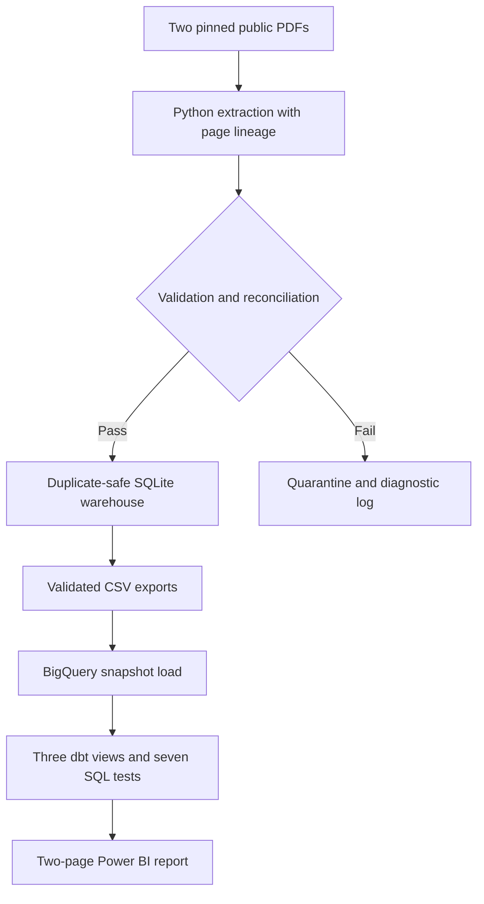
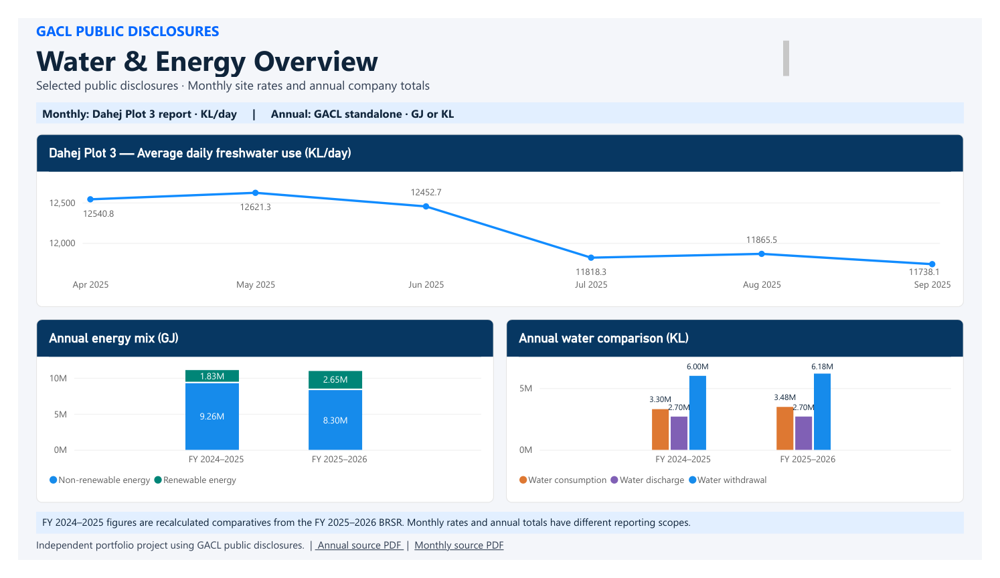
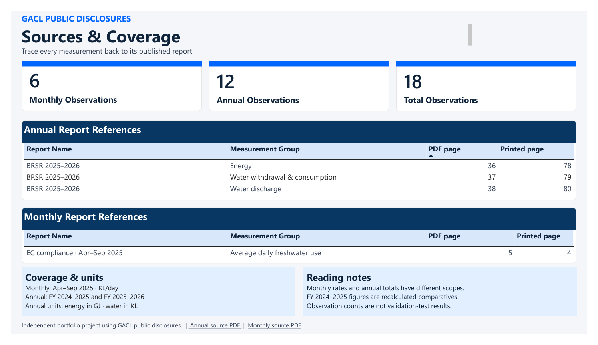

# GACL Public-Disclosure Pipeline and Research Assistant

A portfolio project by **Saurabh Zambare** that turns GACL's public water and
energy disclosures into traceable, validated observations and is being extended
into an evidence-grounded research assistant. The data pipeline is verified;
the AI extension is a guided implementation, not a completed AI service.

**Current status:** the local Python → SQLite → CSV pipeline works with **18 real observations** from two official reports. The user has verified the BigQuery raw table has 12 annual and 6 monthly rows, with no duplicate keys. The live dbt build created 3 views and passed 7 SQL tests. All eight reference checks passed for values, dates, units, scopes and row counts across raw and dbt views. The two-page Power BI report is built, the user confirmed a successful Desktop refresh, and the exported PDF was reviewed on 24 November 2026. A subsequent [manual end-to-end verification](docs/VERIFICATION_2026-11-24.md) passed from cached PDF extraction through BigQuery, dbt, reference comparison and Desktop refresh.

This is independent work using public disclosures; it is not affiliated with or commissioned by GACL.

## Pipeline preview



| Inspectable output | Recorded scope |
|---|---|
| Monthly site observations | **6** monthly daily-average water rates |
| Annual company observations | **12** annual water and energy totals |
| Cloud reference reconciliation | **8** checks passed for the selected facts |

This is an architecture/output preview of the implemented project, not a live plant dashboard. Monthly site rates and annual company totals retain their separate grains and units. [Reviewed sample exports](data/examples/) · [Current verification and pending work](docs/STATUS.md)

## Phase 2 — AI-assisted public-disclosure research

The planned assistant will retrieve report evidence, read validated measurements,
calculate compatible comparisons and generate cited explanations. A later
bounded agent will select approved read tools dynamically. Pretrained semantic
retrieval applies ML without claiming a model trained on the 18 observations;
custom forecasting is deferred until suitable data exists.

| Capability | Evidence/status |
|---|---|
| Python → SQLite → BigQuery/dbt → Power BI | Verified Phase 1; dated evidence linked above |
| Page/chunk indexing and keyword search | Local reference prototype; Windows feature verification/publication pending |
| Pretrained embeddings and semantic search | Planned; model/runtime not yet selected |
| Validated numerical assistant tools | Planned; existing observations remain authoritative |
| Cited RAG answers and GenAI explanations | Planned; no generator/provider selected |
| Dynamic bounded tool use and local interface | Planned; no agent or hosted service claimed |

Saurabh implements one step at a time; the assistant maintains documentation.
The [Phase 2 Master Build Order](docs/PHASE_2_BUILD_ORDER.md) defines 30 stable
steps in eight stages. **Steps 1–3 execution and the Step 3 checkpoint are
verified. Step 4 software and real-page metadata checks passed on Windows:
70 usable pages from 71 physical pages, 18 preserved numerical observations,
four passing dataset checks and 45 passing software tests (32 existing plus
13 retrieval tests). The learner committed and published the implementation as
29795de on [feature/phase2-guided](https://github.com/Saurabhzambare/gacl-public-disclosure-pipeline/tree/feature/phase2-guided).
The clean tracking branch and published source were reviewed. The author then
merged the newer documentation and pushed 53b9be4; clean tracking status and
Markdown-only merge changes are verified. The Git checkpoint is complete.
Learner visual confirmation of two annual review notes and the understanding
discussion remain before Step 5.** The feature has not been merged into main.
Existing prototype work does not mark learner steps complete.

### Existing retrieval reference

The first retrieval milestone is implemented on the local `feature/document-retrieval`
branch: verified PDF-page indexing, keyword search with citations, and a 40-case
pilot evaluation set. It indexes **70 text pages / 136 chunks** from the two
pinned documents. Expected pages appeared in the top five results for **26 of 28**
answerable cases; 12 unsupported/adversarial cases are diagnostic only.
Embeddings, generated answers and agents are still planned. This feature's
Windows verification and public branch publication are pending. The prototype's
runtime, configuration, tests and case JSON files are not included in this
documentation-only update; follow the build order to implement them personally.

[Search commands and limitations](docs/RETRIEVAL.md) ·
[Evaluation evidence](docs/RETRIEVAL_EVALUATION.md) ·
[AI extension scope](docs/AI_EXTENSION_PLAN.md) ·
[Build order](docs/PHASE_2_BUILD_ORDER.md) ·
[Concepts and ELI5 guide](docs/AI_CONCEPTS.md)

## Power BI report

[View the two-page report PDF](dashboard/GACL_Public_Disclosure_Report.pdf) · [Report setup, measures and refresh](dashboard/README.md)

**Water & Energy Overview** keeps monthly Dahej Plot 3 freshwater rates separate from annual GACL standalone energy and water totals.



**Sources & Coverage** shows 6 monthly and 12 annual observations, source page references, units and reading notes. Counts describe observations, not validation-test results.



The PDF and previews are static exports, not an interactive hosted report. The editable PBIX remains on the author's laptop and is not included in this repository. A recorded walkthrough is still pending; [the demonstration script](docs/WALKTHROUGH.md) is ready.

## What the project demonstrates

- Downloaded PDFs verified against pinned SHA-256 checksums.
- Deterministic, document-specific text extraction with source/page lineage.
- Exact decimal parsing, including Indian number formatting.
- Separate monthly site rates and annual company totals.
- Validation, quarantine files, bounded download retries and run history.
- Duplicate-safe local loads and reloads of individual historical sources.
- A credential-free local path, plus a verified BigQuery/dbt reporting route.
- A refreshed two-page Power BI report with units, reporting boundaries and source references.

## Billing-free BigQuery route

The optional loader now requires an explicit mode. `--mode snapshot` uploads the
complete validated local export with one batch replacement job and executes no
DML, so it is intended for the user's billing-free sandbox. The cloud table is a
copy of the local export, not an independent history store. The user has verified live table counts and absence of duplicate keys; full
reference reconciliation and live dbt views/tests are verified. The Power BI report and successful Desktop refresh are now evidenced by the exported report and user confirmation. Follow [BigQuery setup](docs/BIGQUERY_DBT.md).

## The data

| Dataset | Grain | Initial coverage |
|---|---|---|
| Dahej Plot 3 freshwater consumption | Monthly average daily rate, KL/day | Six months, April–September 2025 |
| GACL standalone energy and water disclosures | Annual totals, GJ or KL | Six metrics × two financial years |

Source links, PDF pages, checksums and definitions: [source register](docs/SOURCES.md) and [data dictionary](docs/DATA_DICTIONARY.md).

These are historical public disclosures, not SAP transactions, a sensor feed or live SCADA data.

## Quick start

Python **3.11 or newer** is required. Development was verified on Python 3.12.14.

### Windows PowerShell

Clone this public repository with GitHub Desktop, or run:

```powershell
git clone https://github.com/Saurabhzambare/gacl-public-disclosure-pipeline.git
cd gacl-public-disclosure-pipeline
py -3.11 -m venv .venv
.\.venv\Scripts\python.exe -m pip install -e .
.\.venv\Scripts\python.exe -m gacl_pipeline
.\.venv\Scripts\python.exe -m unittest discover -s tests -v
```

### macOS / Linux

```bash
git clone https://github.com/Saurabhzambare/gacl-public-disclosure-pipeline.git
cd gacl-public-disclosure-pipeline
python3 -m venv .venv
.venv/bin/python -m pip install -e .
.venv/bin/python -m gacl_pipeline
.venv/bin/python -m unittest discover -s tests -v
```

The first run downloads approximately 14 MB of public PDFs. Later runs reuse checksum-verified cached files. No cloud credentials are needed.

On Windows, the downloader uses native certificate validation through pinned
`truststore`. After pulling this update into an existing clone, rerun
`python -m pip install -e .` using that clone's virtual-environment interpreter.
Certificate and document checksum verification remain enabled.

If HTTPS certificate verification blocks the report download, explicitly use the
reviewed extracts already included in the repository:

```powershell
.\.venv\Scripts\python.exe -m gacl_pipeline --from-examples
```

This mode makes no network requests. It checks the CSV snapshots against pinned
normalized-text checksums, validates their records, and runs the same warehouse
load and reporting exports. Expected: `input_mode: reviewed_extracts`,
`loaded_rows: 18`, `warehouse_rows: 18`, `extracted_rows: 0` and
`pdfs_verified_this_run: false`. The original PDF lineage is preserved, but this
does not claim a fresh PDF download or verification. See [HTTPS troubleshooting](docs/HTTPS_TROUBLESHOOTING.md).

Expected first-run output: `status: success`, `extracted_rows: 18`, `warehouse_rows: 18` and four passing dataset-level checks. Run identifiers and times vary.

After a successful first run, use `--offline` to avoid downloads. For a historical source reload:

```powershell
.\.venv\Scripts\python.exe -m gacl_pipeline --offline --source gacl_dahej_plot3_ec_2025_h1
```

Use `--refresh` to re-download against the pinned checksum. A changed source stops the run for review.

## Outputs

- `data/warehouse/gacl.sqlite`: local observations and execution history.
- `data/processed/monthly_site_observations.csv`: six monthly site rates.
- `data/processed/annual_company_observations.csv`: twelve annual totals.
- `data/processed/observations.json`: all accepted observations.
- `data/processed/run_manifest.json`: input mode and whether PDFs were verified in this run.
- `logs/latest_run.json`: latest outcome.
- `logs/<run_id>.checks.json`, `.quarantine.json` and `.log`: quality and diagnostic evidence.

Raw source PDFs, databases, working exports, environments and logs are ignored by Git. The reviewed Power BI report PDF and page previews are intentionally included under `dashboard/`. A reviewed, generated snapshot in [data/examples](data/examples/) provides an inspectable example; it is not a replacement for the extraction pipeline.

## Documentation

| Guide | Purpose |
|---|---|
| [Documentation map](docs/README.md) | Reading order and current versus historical records |
| [Phase 2 build order](docs/PHASE_2_BUILD_ORDER.md) | 30 learner-implemented steps, dependencies and acceptance gates |
| [Step 1 lesson](docs/PHASE_2_STEP_01.md) | Readiness check; Windows execution verified on 25 November |
| [Step 2 lesson](docs/PHASE_2_STEP_02.md) | Windows baseline verified: 32 tests, 18 records, four checks |
| [Step 3 lesson](docs/PHASE_2_STEP_03.md) | Verified inspector and local commit checkpoint |
| [Step 4A lesson](docs/PHASE_2_STEP_04.md) | Single-page structured evidence; Windows execution passed |
| [Step 4B lesson](docs/PHASE_2_STEP_04B.md) | Verified implementation and documentation synchronized at 53b9be4; learner source-review confirmation pending |
| [AI scope](docs/AI_EXTENSION_PLAN.md) | Research assistant goals, boundaries and delivery milestones |
| [Learning log](docs/AI_LEARNING_LOG.md) | Current step, learner evidence and next action |
| [AI concepts](docs/AI_CONCEPTS.md) | Technical and ELI5 explanations |
| [AI contracts](docs/AI_CONTRACTS.md) | Evidence, proposed numerical/answer tools and boundaries |
| [AI evaluation plan](docs/AI_EVALUATION_PLAN.md) | Retrieval, answer, citation, numerical and agent checks |
| [Setup](docs/SETUP.md) | Windows/GitHub Desktop and Linux setup |
| [Architecture](docs/ARCHITECTURE.md) | Pipeline stages and storage decisions |
| [Data dictionary](docs/DATA_DICTIONARY.md) | Field definitions, grains and units |
| [Sources](docs/SOURCES.md) | Official reports, checksums and extraction pages |
| [Quality and testing](docs/TESTING.md) | Checks, failure cases and commands |
| [Operations runbook](docs/RUNBOOK.md) | Reruns, failures and source changes |
| [Cloud setup](docs/BIGQUERY_DBT.md) | Optional BigQuery loader and dbt configuration |
| [Power BI report](dashboard/README.md) | Actual report, measures, evidence and refresh instructions |
| [Walkthrough script](docs/WALKTHROUGH.md) | Recording outline; video not yet recorded |
| [Phase 1 plan](docs/PROJECT_PLAN.md) | Historical 22 November target and dated checkpoints |
| [Status](docs/STATUS.md) | Verified work and remaining tasks |
| [24 November verification](docs/VERIFICATION_2026-11-24.md) | Actual local run, cloud job/expiration, dbt, query and Desktop refresh evidence |
| [Decisions](docs/DECISIONS.md) | Scope, precision and provenance choices |
| [Security](SECURITY.md) | Credentials and data handling |
| [Contributing](CONTRIBUTING.md) | Development and review checklist |

## Boundaries

The parsers support the two pinned documents, not arbitrary PDFs. Missing months are not synthesized. Annual totals are not distributed across plants or months. Source changes require manual review before a manifest update. A changed document is detected but not automatically accepted.

The dataset is deliberately small; the case study is about engineering correctness,
evidence-grounded retrieval and evaluated answers, not throughput or forecasting.
The AI extension starts from the same two approved PDFs. It does not imply live
SAP/OT access, source expansion, OCR, custom training, paid APIs, a hosted vector
database, new cloud billing or public deployment. See [status](docs/STATUS.md)
before making resume claims.

Original project code is MIT licensed. GACL reports, branding and source material retain their owners' rights; they are not covered by that license.

