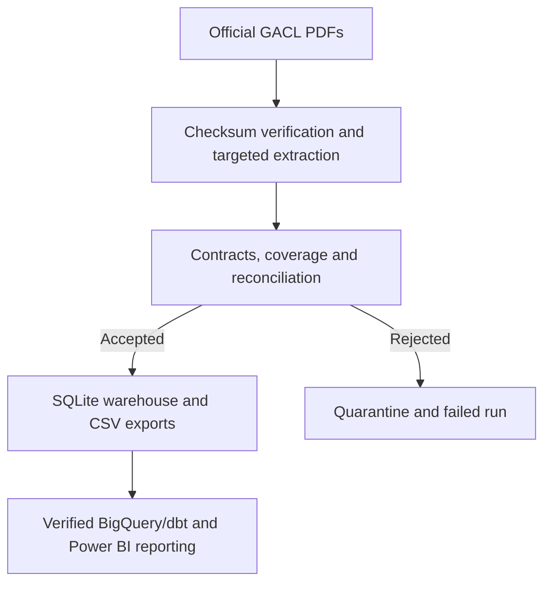
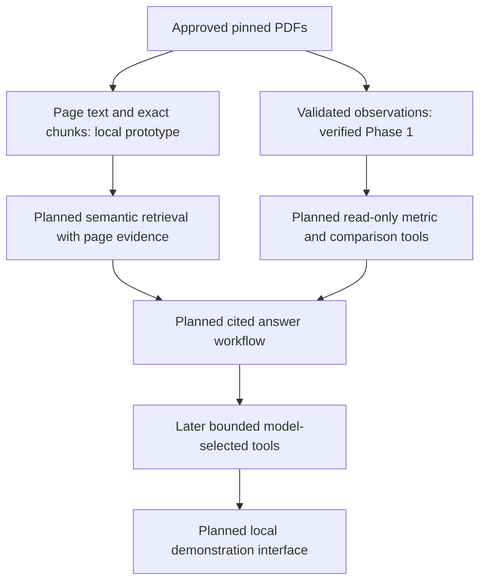

# Architecture

## Current local execution

- config/sources.json defines the only supported reports and expected document hashes.
- download() reuses a verified local PDF or fetches it with bounded retries.
- extract.py uses selected PDF pages and explicit row labels/year order.
- validate.py checks data contracts and selected aggregate relationships.
- store.py writes observations transactionally and retains distinct document versions.
- pipeline.py exports validated history and writes diagnostic artifacts.

## Observation identity

Canonical observation identity is SHA-256 of scope, metric, start/end dates, unit and statistic. Storage uniqueness additionally includes source_id and document_sha256. Reprocessing identical inputs updates the same record.

There is no automatic preferred-version policy. Revised documents must be reviewed. Future multi-version exports must resolve version conflicts explicitly before aggregating.

## Reporting boundaries

The BRSR's PDF page 1, printed page 43, item 13 explicitly says standalone. Annual rows therefore use gacl_standalone. Monthly rows use dahej_plot3_report to preserve the source report boundary without claiming a finer plant-meter scope.

Annual company totals and monthly site daily averages have different grains. They remain separate in exports and dashboard visuals.

## Precision

Values are parsed with Decimal and stored as decimal strings, not binary floating point. This preserves the source precision. dbt casts the cloud raw string field to BigQuery NUMERIC. Presentation rounding must not change stored observations.

## Reliability

Download retries: at most three attempts; retryable HTTP statuses are 408, 429 and selected 5xx statuses. Layout changes, checksum changes and validation failures are not transient errors. Failed runs are recorded in SQLite and logs.

Validation occurs before the observation transaction. CSV export happens afterward; if export fails, the run fails but already committed observations remain safe to rerun. This is not a distributed transaction across SQLite, CSV and cloud storage.

## Verified reporting route and optional paths

- BigQuery sandbox mode validates the complete export and replaces observations with one atomic batch load; it executes no DML.
- Optional explicit MERGE mode preserves staged upsert behavior outside the billing-free route.
- dbt creates typed, separate monthly/annual views and tests.
- Power BI imports curated outputs.
- The reporting route has dated manual verification; see
  [the evidence record](VERIFICATION_2026-11-24.md).
- Scheduling remains pending. Phase 2 RAG follows the separate build order;
  industrial protocol demonstrations are outside that scope.

## Reviewed-extract input mode

Use --from-examples when the report website is unavailable. It validates the pinned repository CSV snapshots, runs the normal data checks and loads the warehouse without downloading PDFs. Run history and data/processed/run_manifest.json record input_mode=reviewed_extracts and pdfs_verified_this_run=false. This is distinct from --offline, which verifies cached source PDFs. The local test suite includes no-network execution, duplicate-safe reruns, altered-snapshot rejection, Windows newline handling, certificate failure handling and migration of existing run history. See docs/HTTPS_TROUBLESHOOTING.md from the repository root.

## Cloud snapshot boundary

The user chose billing-free BigQuery sandbox operation. --mode snapshot replaces
the cloud table with the complete accepted local export; it does not retain
cloud-only history missing locally. Coverage of both configured sources must
pass before any cloud call. One WRITE_TRUNCATE batch job avoids partial
replacement; the loader checks the resulting row count and records the job ID.
No SQL/DML, delete-before-load or change to billing settings occurs. Local SQLite
remains the source of retained document-version history. Concurrent snapshot
writers and multi-version conflict resolution are not supported.

## Local document retrieval extension

The feature/document-retrieval branch adds a separate data/retrieval/index.sqlite
for text pages, exact-span chunks, explicit page metadata, source versions and a
build manifest. Builds use only checksum-verified cached PDFs and atomically
replace the index after success. Read-only FTS5 queries return cited candidate
passages, not generated answers; the observation warehouse is not modified.
A 40-case pilot measures page retrieval separately from future answer and agent
evaluation. See [retrieval](RETRIEVAL.md) and [measured results](RETRIEVAL_EVALUATION.md).

## Planned Phase 2 answer architecture

Document evidence and numerical facts remain separate routes. An LLM can explain
the deterministic calculator result, but cannot provide authoritative input
values or silently reinterpret units/periods. Scope ambiguity requires explicit
clarification. Full-page context and known annotations remain inspectable.

Vectors must resolve to canonical chunk IDs and pin model/revision, dimensions,
preprocessing and index fingerprints. Start with exact similarity for this small
corpus; no hosted vector database is required. The generator/provider and UI
framework are not yet selected. Model memory, runtime, rights and optional API
costs are reviewed at their numbered steps before installation/use.

A fixed answer workflow precedes the agent. Agentic behavior requires actual
dynamic model-selected read tools, validated arguments, application-enforced
budgets and inspectable observable traces. No arbitrary shell, write-SQL or
external messaging tool is included. [Contracts](AI_CONTRACTS.md) define these
boundaries; [evaluation](AI_EVALUATION_PLAN.md) defines the separate checks.

Saurabh implements the [30-step build order](PHASE_2_BUILD_ORDER.md), starting
with pending Step 1. Future modules named there are design targets, not created
files or completed features. Existing storage and reporting behavior are retained.
