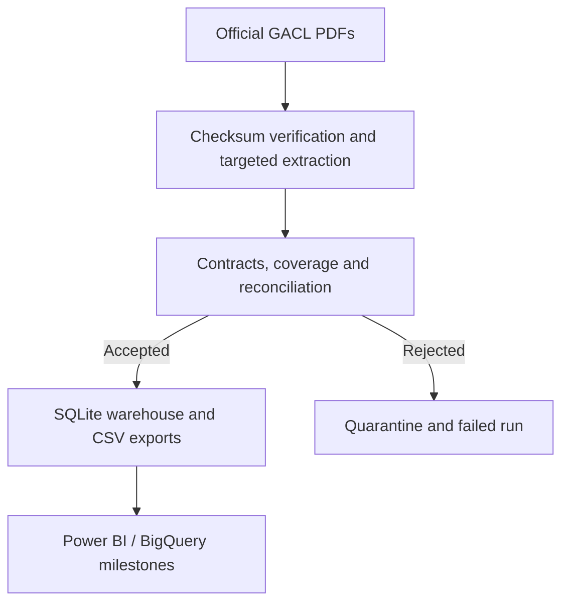

# Architecture

## Current local execution

- config/sources.json defines the only supported reports and expected document hashes.
- download() reuses a verified local PDF or fetches it with bounded retries.
- extract.py uses selected PDF pages and explicit row labels/year order.
- validate.py checks data contracts and selected aggregate relationships.
- store.py writes observations transactionally and retains distinct document versions.
- pipeline.py exports validated history and writes diagnostic artifacts.

## Observation identity

Canonical observation identity is SHA-256 of scope, metric, start/end dates, unit and statistic. Storage uniqueness additionally includes source_id and document_sha256. Reprocessing identical inputs updates the same record.

There is no automatic preferred-version policy. Revised documents must be reviewed. Future multi-version exports must resolve version conflicts explicitly before aggregating.

## Reporting boundaries

The BRSR's PDF page 1, printed page 43, item 13 explicitly says standalone. Annual rows therefore use gacl_standalone. Monthly rows use dahej_plot3_report to preserve the source report boundary without claiming a finer plant-meter scope.

Annual company totals and monthly site daily averages have different grains. They remain separate in exports and dashboard visuals.

## Precision

Values are parsed with Decimal and stored as decimal strings, not binary floating point. This preserves the source precision. dbt casts the cloud raw string field to BigQuery NUMERIC. Presentation rounding must not change stored observations.

## Reliability

Download retries: at most three attempts; retryable HTTP statuses are 408, 429 and selected 5xx statuses. Layout changes, checksum changes and validation failures are not transient errors. Failed runs are recorded in SQLite and logs.

Validation occurs before the observation transaction. CSV export happens afterward; if export fails, the run fails but already committed observations remain safe to rerun. This is not a distributed transaction across SQLite, CSV and cloud storage.

## Next milestones

- Optional BigQuery loader stages rows and merges by observation/source/version.
- dbt creates typed, separate monthly/annual views and tests.
- Power BI imports curated outputs.
- Scheduling, RAG and industrial protocol demonstrations are separate future work.

## Reviewed-extract input mode

Use --from-examples when the report website is unavailable. It validates the pinned repository CSV snapshots, runs the normal data checks and loads the warehouse without downloading PDFs. Run history and data/processed/run_manifest.json record input_mode=reviewed_extracts and pdfs_verified_this_run=false. This is distinct from --offline, which verifies cached source PDFs. The 22-test suite includes no-network execution, duplicate-safe reruns, altered-snapshot rejection, Windows newline handling, certificate failure handling and migration of existing run history. See docs/HTTPS_TROUBLESHOOTING.md from the repository root.
